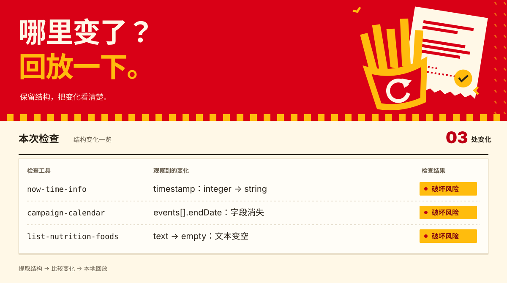

# MaiReplay · 麦回放

**把一次麦当劳 MCP 查询变成可复现的本地结构测试。**

面向维护麦当劳 MCP Skill、解析器和演示应用的个人开发者：删除响应真实值，保留结构，比较变化，再通过标准 MCP 在本地回放。测试不需要会员 Token，也不访问真实业务服务。



> 首版演示全部为**合成数据**。尚未使用授权 Token 完成官方认证实测；结构回放不能验证价格、营养数值、活动日期或业务资格。

## 解决什么问题

“昨天能解析，今天为什么空了？”官方文档未提供完整机器可读 schema，公开反馈与参赛项目中又出现了 JSON、文本封装和空响应的差异。开发者通常只能反复登录重试，或把真实会员响应留在测试目录。

MaiReplay 提供可检查的另一条路径：在正常 AI 客户端中明确触发必要查询 → 本地删除值 → 比较观察到的结构 → 将合成样本交给适配器回归测试。它不是套餐推荐器，也不执行领券或下单。

- **结构观察包**：识别完整 JSON、代码围栏 JSON、`## Original Response` 后的 JSON，以及未解析文本与空文本。
- **变化检测**：工具删除、必填参数增加、字段消失、类型和封装变化；区分 `breaking`、`review`、`info`。
- **本地 MCP 回放**：官方 Python MCP SDK、stdio 协议；复用已记录的三种只读工具。
- **本地接收工具与 Skill**：接收一次正常官方查询的结果，在内存中删除原值后写入文件。
- **可用于 CI**：离线命令、明确退出码、无外部脚本和追踪的 HTML 报告。

支持的官方工具仅有 `now-time-info`、`campaign-calendar`、`list-nutrition-foods`，详见 [MCP_INTEGRATION.md](MCP_INTEGRATION.md)。它们在官方服务上仍需要认证。

## 30 秒离线试用

需要 Python 3.11+，以下命令使用 Linux/macOS 风格终端；当前测试环境为 Linux。文件安全操作依赖 POSIX 接口，首版未验证 Windows 支持。源码安装，目前不宣称已发布到 PyPI。

```bash
git clone https://github.com/YoyoLin008/maireplay.git
cd maireplay
python -m venv .venv
source .venv/bin/activate
python -m pip install -e .
maireplay demo --out-dir demo-output
```

打开 `demo-output/report.html`，查看刻意加入的结构变化。演示不会连接麦当劳，也不会读取 Token。输出目录必须是尚未存在的新目录。

```bash
maireplay compare demo-output/before.json demo-output/after.json
# 该演示包含破坏性变化，因此 compare 预期退出码为 2。
```

可运行 `python examples/check_adapter.py demo-output/before.json` 查看独立 SDK 适配器通过；将文件换成 `after.json` 会检测到刻意加入的类型变化并退出 2。这里的 `timestamp` 是演示自定义字段，不是官方 schema 承诺。

退出码：`0` 无变化或仅信息项；`2` 有破坏性风险；`3` 仅需人工复核；`1` 输入或执行失败。单次样本不变不等于兼容性得到证明。

## 三个实际开发工作流

### 1. 修改解析器前，先比较样本

```bash
maireplay import private/export-before.json --out private/before.json
maireplay import private/export-after.json --out private/after.json
maireplay compare private/before.json private/after.json --html private/report.html
```

导入格式与字段含义见 [集成文档](MCP_INTEGRATION.md#本地导入格式)。原始导出文件由你保管，导入命令不会删除它。不要将 `private/` 提交到仓库；输出文件拒绝覆盖已有文件。

### 2. 用本地样本测试 MCP 客户端

将客户端的一个独立连接配置为以下 stdio 服务；替换绝对路径，不需要任何 Token：

```json
{
  "mcpServers": {
    "maireplay-offline": {
      "command": "/absolute/path/to/.venv/bin/maireplay",
      "args": ["replay", "/absolute/path/to/demo-output/before.json"]
    }
  }
}
```

只启用离线连接进行适配器测试，避免与真实同名工具混淆。返回的是值已删除的合成响应；金额为零或文本占位符不具有业务含义。

### 3. 在正常 AI 客户端中保存一次结构观察

将仓库的 `skills/maireplay/` 作为一个技能目录导入支持 `SKILL.md` 的客户端（目录位置按客户端文档设置）；[Skill 原文](skills/maireplay/SKILL.md) 可以审查。连接官方 MCP 及本地接收服务：

先在项目目录运行 `mkdir -m 700 private`，再将下面的绝对路径替换为本机实际路径。接收服务要求父目录已存在，输出文件尚未存在。

```json
{
  "mcpServers": {
    "maireplay-local": {
      "command": "/absolute/path/to/.venv/bin/maireplay",
      "args": ["capture", "--out", "/absolute/path/to/private/observation.json"]
    }
  }
}
```

向客户端明确提出：“查询一次当前麦当劳活动，并用 MaiReplay 保存其结构供我本地测试。”Skill 只允许必要的一次官方只读查询，然后将完整 `CallToolResult` 交给本地 `record_mcd_observation`。一次接收服务只写一个新文件；需要新观察时配置新路径并重启。

官方连接使用 `https://mcp.mcd.cn`、Streamable HTTP 和 Bearer Token。安全配置示例见 [mcp-config.example.json](mcp-config.example.json)；环境变量展开方式因客户端而异，须按客户端文档配置。不要把 Token 发到聊天、Issue 或 MaiReplay。

## 架构

```text
用户明确查询 → 正常 AI MCP 客户端 → 官方 MCP（三种只读工具）
                         │ 完整结果，瞬时传递
                         ▼
                 本地 capture / import
                  验证 → 删除值 → 结构包
                            ├─ compare → 终端 / HTML / CI 退出码
                            └─ replay → 本地 stdio MCP → 适配器
```

业务处理与 MCP 服务分离；CLI 和比较逻辑均可离线使用。工具名称固定允许列表，未知工具及交易工具被拒绝。原始响应的字符串、数字、布尔值变为合成占位符；仅保留必要的 MCP 协议标记和结构信息。

## 测试与开发

```bash
# requirements.lock 记录本次验证的完整运行依赖版本（不含工具开发依赖）
python -m pip install -r requirements.lock
python -m pip install -e '.[dev]'
pytest -q
ruff check .
python -m build
```

测试覆盖值删除、异常输入、结构差异，以及标准 MCP 客户端到本地服务的协议路径。没有官方认证端到端测试，也没有将合成服务的错误测试当成官方 401/429、超时或可用性验证。具体证据见 [QA 报告](docs/QA.md)。

## 边界、安全与规则

结构包记录的是**这次观察**，不是官方完整 schema。复杂 JSON Schema 约束会被保守处理；普通文本不能恢复业务结构；空数组无法证明元素类型。[完整限制](docs/limitations.md)

MaiReplay 不接收 Token、不提供远端采集器、不做定时查询或真实服务 CI。官方 [服务规则](https://cdn.mcd.cn/cms/pages/MCPServerRules.html) 对自动化访问有限制；本项目采用正常客户端明确查询后的本地处理，不宣称获得任何规则豁免。

值删除也不等于匿名化保证：英文字母/下划线键名会保留，嵌入其中的敏感信息仍可能泄露。分享前必须审查结构包；真实导出、个人观察包和报告默认只应保留本地。[安全说明](SECURITY.md)

## 研究、许可与致谢

选题前检查了全部 33 个官方文档工具和 10 个参赛项目的 README 与实现：[能力矩阵](docs/capability-matrix.md)、[竞争研究](docs/competitive-research.md)、[加权选题](docs/product-selection.md)、[PRD](docs/PRD.md)。未复制竞品实现，未编造访谈、用户量或节省工时。

原创代码采用 [MIT 许可](LICENSE)。官方声明文件保留原内容，第三方资料及商标不因本项目获得授权。项目为独立开发的非官方作品，与麦当劳无隶属或背书关系；仅按官方条款进行个人非商业集成使用。感谢麦当劳中国开放 MCP 文档、MCP Python SDK 维护者和公开记录问题的开发者。本项目未使用 WorkBuddy，也不申请其专项奖励。
